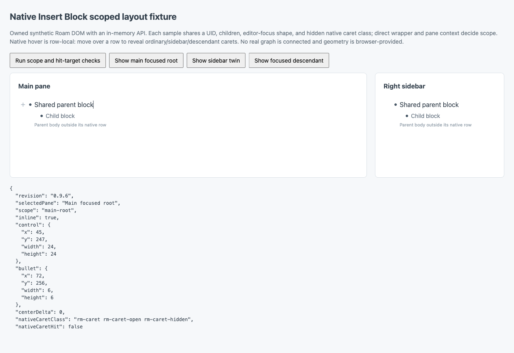
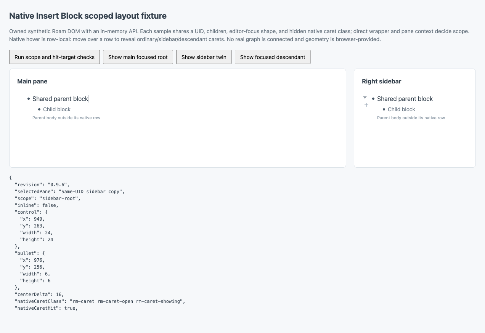

# 0.9.6 scoped-root acceptance

## Scope and evidence boundary

The only new placement exception is a main-pane zoomed root with children, its own Bullet, and an absent or native-hidden own caret. Sidebar copies, ordinary parents, focused-view descendants, references, embeds, queries, mentions, Desk, leaves, Document Mode, and Version Blocks retain their 0.9.3 behavior.

These results come from a real Chromium browser running the owned localhost fixture with an in-memory Roam API. Geometry and MutationObserver delivery are browser-provided; rectangles are not patched. The screenshots contain synthetic text only. Earlier read-only inspection of Roam's public documentation graph established the native main-root/sidebar structure and row-local hover behavior. **The candidate was not installed in a real graph, and these results are not live-extension acceptance.**

## Results

- **78/78 Node tests**, original smoke tests, syntax checks, build, and coverage attribution passed. Extension line coverage: **84.95%**.
- **33/33 browser checks in each of three configurations**: Depot, manual `roamjs.js`, and Depot with the browser's reduced-motion preference. No captured browser errors. See [browser-suites.json](browser-suites.json).
- Trusted mouse input started in the parent body outside its native row, then moved vertically into the native caret. In **0.9.5**, ordinary parents, sidebar roots, and focused descendants blocked caret reveal; clicking that point invoked a mock insert instead of the fixture's native collapse handler. In **0.9.6**, each matched **0.9.3** geometry exactly, revealed the caret, and invoked only native collapse, with zero plugin writes. See [trusted-pane-comparison.json](trusted-pane-comparison.json).
- Leaf, Document Mode, Version Block, and collapsed ordinary-parent geometry also matched 0.9.3 exactly: [additional-baselines.json](additional-baselines.json).
- Five trusted pointer switches between same-UID main/sidebar copies preserved both placement and DOM ownership while editor focus remained in the main input. Sidebar collapse caused no plugin write; a separate intentional main-root plus click caused one mock insert. See [same-uid-switching.json](same-uid-switching.json).
- Replaying the pre-invalidation-fix runtime `b5a1da0` against the final fixture produced **10 failures**: three body-first context exclusions and seven real observer/cleanup cases. All pass in 0.9.6. See [pre-fix-browser-red.json](pre-fix-browser-red.json). Its `mode` identifies the fixture page; the archived manual bundle replaced the initially loaded runtime for this replay.
- Twelve ordinary style/geometry helpers are byte-identical to 0.9.3: [ordinary-baseline-identity.json](ordinary-baseline-identity.json). `src/action-mode.js` and `tests/smoke.js` are unchanged from that baseline.

## Screenshots

Main focused root: the plus uses the inline slot before the Bullet. The sidebar is not hovered.



Same-UID sidebar copy: native caret visible and reachable; plus remains below it. Editor focus is still in the main input, demonstrating that editor focus does not select the placement exception.



Before, in 0.9.5: entering the sidebar caret through the parent-body gutter leaves the plus in the native caret's slot and prevents reveal.


## Reproduce

```bash
npm test
node tests/layout-fixture-server.js
```

Open `http://127.0.0.1:4173/`, then choose **Run scope and hit-target checks**. Repeat with `?mode=roamjs`. The body-first checks deliberately do not dispatch a row-enter event before testing the caret hit target: entering the row first can hide the regression.

For trusted pointer testing, choose **Show sidebar twin** or **Show focused descendant**. Move into the parent body directly below the caret, then vertically up to the caret and click. The arrow should reveal and the child should collapse, without a plugin insertion. To inspect both panes together, run this only in the localhost fixture's console:

```js
const f = window.__nativeLayoutFixture;
f.reset();
f.createCase({ scope: "main-root" });
f.createCase({ scope: "sidebar-root" });
```

Move between those two copies. Only the main zoomed root should use the new inline exception. Native hover/click acceptance uses trusted browser input; the fixture's automated event dispatch is a separate test layer.

## Tested runtime

Runtime revision: `a4c6b64667f2ff90be541b335c8145fee75683aa`. Later acceptance changes add only tests, documentation, and evidence; the runtime bundles remain identical.

```text
extension.js  677d4dd119443235673d9332f9b9a8a7aad8da13d386ef65bc58869c9ff800db
roamjs.js     9cb02db3ecac7123efde2e9251f423ae86252c22fc54dfdbadcc2e497f206138
```
